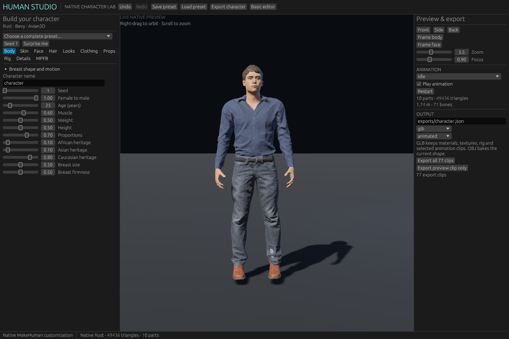
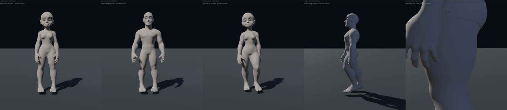

# Human Studio

A native Rust character editor for Bevy 0.20 and Avian3D 0.8. The expanded
customization engine ports Ara 3D Gen's MakeHuman morph lattice, proxy fitting,
rigging, anatomy adjustments and animation playback into Rust. MPFB2 contributes
published-format interoperability and custom-target workflows. Character
construction, editing, rendering, animation and export run without Node, Python,
Blender, a web server or an external generator.



## Run

```sh
cd character_editor
cargo run --bin human-editor
```

The source includes the prepared native asset library. Initial Cargo builds need
network access for Rust dependencies; the editor then works offline. The default
asset directories are resolved from the crate location. The native window needs
a display and a Bevy/wgpu-compatible GPU. Linux uses X11; X11/XKB development
libraries and a working graphics driver must be available.

See [CLI and wardrobe workflows](docs/CLI.md) for garment authoring, reusable
outfits, sampled fit reports and animated exports.

## Cartoon mode

Cartoon mode gives any MakeHuman character the proportions of the Meshy cartoon blanks,
styled toward stylised turnaround references (big heads and eyes, almond eye openings,
wide hips or broad shoulders). It is one more morph on top of MakeHuman, not a
separate body: gender, age, weight, muscle, breasts, every detail slider,
expressions, skins, eyes, brows, hair, garments and rigs keep their full behaviour.

**In the editor:** tick **Cartoon mode** and set the **Cartoon** amount (0 = realistic MakeHuman, 1 = full cartoon). The female and male
cartoon shapes blend with the gender slider. Offsets scale with body height. Children
(age 12–18) keep the full cartoon head but get a lighter body offset and no adult
chest. Expression units get a matching correction so blinks close the larger eyes
and smiles span the wider mouth. Recipes store this as
`"cartoon": {"enabled": true, "strength": 1.0}`. Recipes saved with the former
`"base"` field still load; it is ignored (the separate Meshy-surface mode was removed).
Headless: `human-cli export --set cartoon.enabled=true -o c.glb`.



**Assets.** `assets/native/cartoon_hm08/cartoon.pack` (about 160 KB) holds the editor data.
`assets/cartoon_hm08/` holds the same data for other tools. `base_female.obj` and
`base_male.obj` are the full-strength shapes on hm08 topology (vertex order, groups
and UVs unchanged). `targets/cartoon/` holds the offsets as `.target` files
(`cartoon-<sex>-head`, `cartoon-<sex>`, `cartoon-<sex>-chest`) plus the expression
corrections. `report.json` records source hashes, landmarks and fit metrics.

**Muscle and bust.** At **Muscle** 1, and for the female also **Breast size** 1, the
cartoon body becomes the Superhuman references (`references/Superhuman_{F,M}.glb`).
The build fits hm08 to each reference, starting from MakeHuman's max-muscle shape (max cup
for the female). It stores the remainder over "max-muscle MakeHuman plus the default cartoon
offset" as `cartoon-<sex>-muscle` and `cartoon-<sex>-muscle-chest` (no head part),
smoothed lightly over the mesh. In the editor, muscle above 0.5 fades the body part in.
The female chest part needs both muscle and breast size, since one reference holds both.
It covers everything MakeHuman's max-cup target moves, with a wide smooth falloff, so a
muscular body never reshapes a smaller bust;
the male chest follows muscle. These fits also pull the surface toward the reference from
the reference's side (bidirectional ICP), so it swells into the large muscles. hm08's
resolution softens the finest definition, such as the abs and the separations between
muscles.

**Rebuild** with `python3 tools/cartoon_hm08/build.py`; it needs Python with NumPy and
SciPy, takes about 30 seconds and is deterministic. The fit uses hand-picked face,
ear, finger and toe landmarks (`tools/cartoon_hm08/landmarks.json`), Meshy rig joints
and rule-based body extremes. It then runs a thin-plate warp and Laplacian-regularised
non-rigid ICP onto the Meshy surface. The eye and lip margins are mapped to almond
eye outlines and the smile line, and the eyeballs, sockets and mouth cavity are rebuilt.
Joint helpers follow the local skin so the rig stays centred in the cartoon limbs.
The limbs are then re-posed to hm08's rest angles (elbow bend, arm drop, wrist, knee and
leg splay; `repose.py`), because every clip is retargeted against that rest pose. The
Meshy blanks stand with straighter elbows, which bent arms wrongly in idle and walk.
The hands are hm08's own, scaled to the cartoon hand's length and made 18% chunkier
across, because fitting hm08's fingers to the Meshy hands fused them. The result is
symmetrised. The visible surface is within 2 mm on average of the Meshy
surface.

Known limits: hm08 has about 14 vertices along each lid, so lid edges are slightly
polygonal before subdivision. Roughly 1% of quads fold (finger webs, toes, ears,
lids). Meshy's sculpted brows are too fine for hm08 and MakeHuman brow proxies are
used instead. Detail face targets (nose, mouth size) keep their realistic magnitude
on the larger cartoon features. Realistic hair proxies can leave small gaps on the
larger skull.

**Cartoon hair.** In cartoon mode every MakeHuman hair uses a solid, sculpted-looking
shell instead of its strand cards (`proxies/cartoon_hair_<id>.pack`). The shells are built
by `python3 tools/cartoon_hair/build.py`, which needs Blender and takes about 10 s. The
cards are evaluated on the base mesh and joined with a lifted copy of the scalp under
them, so sparse cards leave no holes. They are then thickened, voxel-remeshed, smoothed,
puffed out and carved into rounded locks that run down from the crown, and decimated to
about 3,200 triangles. The locks fade out where the hair lies thin over the skin, and no
parting cuts closer than 3 mm to it, so hairlines stay smooth. Each shell vertex borrows
the body binding of the nearest original card vertex, so the shell follows every morph,
including the cartoon head. The colour is the lit half of the cards' texture, as a
flat matte material, and the hair tint multiplies it as before. Shells are closed
volumes built clear of the scalp, so the hair clearance pass skips them.

**Stylised faces.** In cartoon mode each part's texture gets a cartoon pass
(`cartoon_texture` in `src/native_texture.rs`, chosen by the `cartoonKind` that
`native_cartoon::stylise_part` sets). The **skin** keeps only broad regional colour
(lips, cheeks, nails), with the tone lifted slightly. The **eyes** are redrawn: flat white
sclera, a large iris in the eye colour's hue with a dark rim, a big pupil and a
painted highlight. **Lashes** are replaced by one solid lash line along each upper lid
(`tools/cartoon_hm08/lashes.py`, `proxies/cartoon_eyelashes_{female,male}.pack`). It
thickens toward the outer corner and ends in a flick, bold on the female shape and thin
on the male. Each ribbon vertex is bound to one lid-margin vertex, so the line follows
morphs and blinks exactly. **Brows** become solid painted shapes, and **beards** a
matte shell in the beard colour, because strand cards read as speckles at toy scale.
All of it scales with the Cartoon amount and applies in the preview and in exports.
The eye openings are 85% (female) and 100% (male) of the Meshy blanks' eye height
(`EYE_OPEN` in `fit.py`), almond-shaped with the upper lid over the top of the iris.
The eyeball keeps the Meshy eye's size and depth, centred behind the opening so it looks
straight out. The lid margin is laid onto the ball 1.2 mm outside it, and any skin the
ball would poke through is pushed out over it with a smooth falloff, so the lids wrap
the eye with no cavity in front of it (`EYE_CLEAR`, `EYE_BAND`).
The sockets are shallower than the Meshy blank's, matching the reference sheets' near-flush
eyes. Hollows within three opening sizes of each eye are raised toward a smooth membrane
spanning brow, cheek and nose bridge, filling up to 85% of the hollow and fading with
distance (`SOCKET_REACH`, `SOCKET_FILL`). Skin beside the ball is then kept outside
it, so the eye never shows through the temple.

**Arm clearance.** Clips are retargeted against the realistic body, so on the wider
cartoon hips and deeper belly the hands would press into the body. The rig
measures how far the torso reaches outside a hanging arm, seen from the shoulder, on the
realistic and the cartoon body (`arm_clearance` in `src/native_rig.rs`). It then spreads
the upper arms by the difference in every clip, and the forearms by 60% of it.

**Clothing layers.** Garments carry their authored offset from the neutral body, so a
large morph (cartoon hips, high weight) could push trousers out through a top. The
wardrobe build now keeps tops 2 mm outside bottoms and jackets outside both,
measured along the body normal (`separate_layers` in `src/native_wardrobe.rs`).

## Universal Animation Libraries

Quaternius UAL1 and UAL2 can be imported with the native `animation-import`
command. Their 120 and 134 clips use separate `ual1:` and `ual2:` IDs and appear
in the GUI animation search and CLI clip catalog. The importer also reads each
root-motion companion. See [import and export commands](docs/CLI.md#universal-animation-libraries).
Both supplied libraries include a CC0 1.0 license; the source directories retain
the original Quaternius attribution and license files.

## Customization

The full editor starts with a clothed, textured and animated character. It has:

- 49 parameter controls: body/age/heritage, skin, eyes, brows, lashes, hair,
  beards, tattoos, earrings, clothing, fabrics, footwear, headwear, accessories,
  weapons, bags, vehicles, expressions, teeth, tongue, detail and rig settings.
- All 219 detail sliders and 1,037 source morph targets, including coupled body
  macros. Heritage weights normalize when evaluated. Age uses the reference's
  12–90 year range. The source's clothing/underwear rules for younger characters
  are retained.
- Additional breast volume, projection, lift and separation controls (under Breast
  firmness). Above 1, projection scales how far the mound stands out from the chest wall.
  Below 1 it blends the mound toward a flat chest: a smooth surface spanning its rim,
  reached at the minimum (0.2). It also shapes the areola and nipple (`nipple_relief`). At 1 the areola stands 1 mm above the
  breast and the nipple 3 mm above it; at 2, 5 mm and 12 mm. Below 1 the areola rounds
  off and the nipple inverts, to 2 mm at the minimum. Realistic MakeHuman bodies model
  their own nipples, so they get only the change from 1. Independent breast bones
  have adjustable secondary-motion strength, stiffness and damping.
  Fitted clothing follows the edited silhouette. Motion is included in animated
  GLB exports and can be disabled for a host game to drive the bones itself.
- 20 photo-based skins, automatic skin selection, tint colors, 30 complete
  presets, and deterministic seeded randomization.
- 119 fitted garment/appearance/prop templates with separate surfaces, native
  layering selections and body-face hiding. Pattern and primary/accent colors
  are editable per garment; hair, beard, tattoo and metal colors are independent.
- Game, game-lite and full MakeHuman skeletons, A/T bind poses, optional facial
  bones, a `WeaponR` attachment socket and 77 sampled animation clips.
- Facial expressions, native blinks and speech preview, optional 34 facial
  shape/viseme targets, and native lip closure/heel arch adjustments.
- Low/medium/high mesh density, textured GLB and OBJ export, undo/redo,
  recipe save/load and a searchable detail panel.

Right-drag the viewport to orbit, scroll to zoom, or use Front/Side/Back and the
body/face framing buttons. Changes are rebuilt on a worker thread after a short
debounce. The previous valid character stays visible until its replacement is
ready. Animation and camera input run in Bevy; Avian receives a capsule sized to
the generated character. Animation previews stay in place so the game controller
can own root movement and physics. The original 24-control editor and its drop
test remain available through **Basic editor**. Switching modes preserves the
full native recipe as a saved draft, including its custom targets.

The native implementation uses reusable fitted geometry and sampled motion data
rather than executing the reference's JavaScript procedural generators. Garment
fit and motion retargeting should be reviewed for extreme proportions. Low detail
uses the canonical body mesh when clothing occlusion is active to preserve garment
boundaries. High mesh density refines triangles; it is not a skin-detail sculpt.
The bicycle is a native scene prop. This is a character editor for game integration, not a port
of Blender, Rigify, or every MPFB panel. FBX export and Blender material node
graphs are not implemented.

## MPFB / MakeHuman interoperability

The MPFB panel imports `.target` and `.target.gz` files against hm08's original
vertex numbering. Imported deltas travel inside the recipe, can be weighted or
mirrored across X, and participate in native character generation. File offsets
remain MakeHuman Y-up XYZ decimeters; they are not converted into Blender's Z-up
coordinate frame.

MHM import/export supports the documented body macros, compatible detail controls
and recognized MakeHuman assets. Unsupported geometry-changing directives return
an error. Standard MHM directives represent the interoperable subset; a validated
`# human-studio` JSON comment preserves the complete native recipe, including
procedural wardrobe, colors and custom deltas, when reopened in Human Studio.
Other applications ignore that comment and only receive the standard subset.
Use Human Studio JSON for complete editable projects.

## Custom wardrobe library

Place imported custom-garment JSON definitions in
`assets/native/custom_garments/`. The native asset loader validates every
`*.json` definition once when it starts, including any `map`, `diffuse`,
`normal`, or `normalMap` texture path relative to `assets/native`. The Clothing
panel groups usable definitions by slot. Selecting a top, bottom, jacket, feet,
or hat replaces the custom item in that slot; accessories toggle independently
by ID. A selection clears the conflicting built-in outfit/slot setting and
keeps custom garments in the other slots. Invalid definitions and missing textures
remain visible in the panel as errors and never interrupt character rebuilding.
Selected garments are stored directly in Human Studio recipes, so save/load and
runtime rebuilding do not depend on the source library still being present.

Imported hair, beards and clothing refit whenever the head or body changes.
Their body anchors follow the morphed surface. A shared deformation field
rotates and scales each item's authored offset, using the broader head/body
transform for distant strands and bounded local adjustments near the skin. This
also supports direct vertex bindings used by beard shells and scalp linings.
The fit runs after cartoon, custom-target and body-shape changes; source
geometry in saved recipes stays unchanged, so switching shapes does not
accumulate deformation. Imported hair also receives bounded clearance at the
scalp and neck; inward wig surfaces are preserved. Deep intersections remain
reported for asset review. The viewport and native exports use the same fit.

The sprite-sheet wardrobe pilot includes four selectable **source drafts**:
Engineer navy utility coat, Engineer charcoal trousers, Engineer white sneakers,
and Alchemist blue waistcoat. Their source meshes retain their proportions;
the coat uses separate upper-arm/forearm fitting rather than a shorter native
jacket mesh. The catalog is read at startup, so reopen the rebuilt editor to
discover newly generated definitions.

Two ready-to-open Full editor projects are saved at
`../generated/wardrobe-library/review/source-library-pilot-female.json` and
`../generated/wardrobe-library/review/source-library-pilot-male.json`. They mix
the Engineer pieces with the Alchemist waistcoat. Both pass CLI geometry
validation. Front/side/back and sampled idle/walk previews were reviewed, but
the collision diagnostic retains warnings: these are drafts, not completed
production assets. The rest of the source library is still being processed.

## Native command line

The complete [headless CLI reference](docs/CLI.md) covers discovery, all parameter
and detail controls, breast settings, custom targets, MHM conversion, validation,
inspection, Basic projects, and manifest-based batch exports. Use `human-cli`,
or `human-editor --headless` with an editor build. CLI-only builds exclude the
window event loop and X11 integration:

```sh
cargo build --no-default-features --bin human-cli
./target/debug/human-cli --help
./target/debug/human-cli create --preset "Athletic woman" --output woman.json
./target/debug/human-cli export --input woman.json --clip walk --output woman.glb
```

The headless authoring binary uses exactly the same Rust generator and exporter:

```sh
cargo run --no-default-features --bin human-export -- --list
cargo run --no-default-features --bin human-export -- \
  --preset "Athletic woman" --out exports/woman.glb --clip walk
cargo run --no-default-features --bin human-export -- \
  --params exports/character.json --out exports/character.glb --all-clips
cargo run --no-default-features --bin human-export -- \
  --seed 42 --out exports/npc.obj
```

`--params` accepts a Human Studio project, a native recipe, or reference-style
parameter JSON. `--assets DIR` overrides the native asset directory. GLB embeds
textures, materials, selected rig/animation data and optional facial targets;
OBJ writes an MTL and adjacent PNG textures. Export parameters also let you
choose static, rigged or animated GLB output.

## Embed in a game

```toml
[dependencies]
human_editor = { path = "../character_editor", default-features = false }
# Match this crate's Bevy and Avian versions in the host.
```

```rust,no_run
use avian3d::prelude::*;
use bevy::prelude::*;
use human_editor::{CharacterPlugin, CharacterRecipe, CharacterShape};
use human_editor::{ara::AraRecipe, native_runtime::NativeAssets};

fn configure(app: &mut App, assets: NativeAssets) {
    // The host installs DefaultPlugins and PhysicsPlugins once.
    app.insert_resource(assets).add_plugins(CharacterPlugin);
}
fn spawn_character(mut commands: Commands) {
    commands.spawn((
        CharacterShape(CharacterRecipe {
            customization: Some(AraRecipe::default()),
            ..default()
        }),
        Transform::from_xyz(2.0, 0.0, 0.0),
        RigidBody::Kinematic,
    ));
}
```

Load `NativeAssets::load(".../assets/native")` once and share it across characters.
Change `CharacterShape.0.customization` to rebuild. `NativeInstance` exposes the
built character, clip selection, playback and time. Meshes, native images and
materials belong to managed child entities; root destruction removes them.
Failed recipes attach `CharacterBuildError` and are retried only after a change.
Each character retains its own configuration and locomotion collider. Roots use
meters, Y-up, feet at their local origin, facing +Z.

`CharacterPlugin` creates no camera, lights, floor, UI, or physics world. It also
supports the original lightweight morph library through `CharacterLibrary` and
recipes without `customization`. When both engines are used, insert both library
resources. Standalone and in-game editor examples do this explicitly.

With the `editor` feature, add `CharacterEditorUiPlugin` for the panels without
creating another scene. Set `EditorState.selected` to a host-owned character.
Mark a camera with `EditorCamera` to opt into orbit controls. Selection transitions
reset history and restore an active basic drop preview's original physics state.
`CharacterEditorPlugin` combines those panels with the standalone studio scene.

```sh
cargo run --example in_game_editor
cargo run --no-default-features --features window --example embedded
```

Live editable instances use CPU skinning. For production GPU skinning and
pre-authored game characters, load exported GLBs with Bevy's normal scene and
animation APIs; the game then needs neither the generator nor its source assets.

## References, assets and licenses

[Third-party notices](THIRD_PARTY.md) records source revisions, attribution and
licensing. [Native asset provenance](assets/native/PROVENANCE.json) records file
hashes. The original small library's provenance remains under
`assets/makehuman/PROVENANCE.md`.

The reference TypeScript/Python/Blender applications are not runtime dependencies.
The development-only scripts under `tools/` convert catalogs, procedural source
geometry, paint masks and sampled animation data into portable assets. Those
scripts use the vendored pinned Ara source; they are not called by Cargo, the
editor, the Rust library or exports. MakeHuman graphical data is CC0. Ara's code
is MIT; its required notice is included. CMU-derived motion data has separate
terms, including the restriction against reselling motion data by itself.
MPFB's Blender code is GPL and has not been incorporated; the format reader is
an independent implementation of its published conventions.

## Validation

```sh
cargo fmt --check
cargo check --all-targets
cargo test --lib --tests
cargo check --no-default-features --features window --example embedded
HUMAN_EDITOR_SMOKE=/tmp/human-studio.png cargo run --bin human-editor
```

The smoke option waits for the native character build, captures the rendered
window, then exits. Tests cover real native characters, morph extremes, parsing,
MHM/custom-target interchange, anatomy adjustments, rigs/motion, asset reuse,
Avian ground contact, persistence and GLB import into Bevy.
