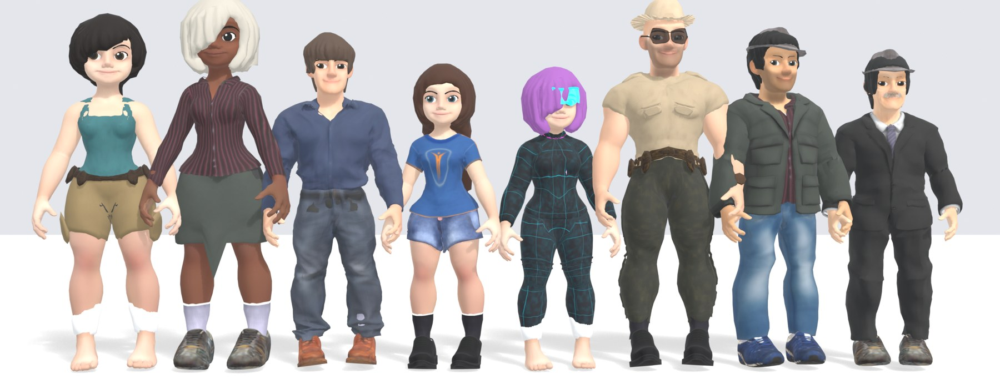
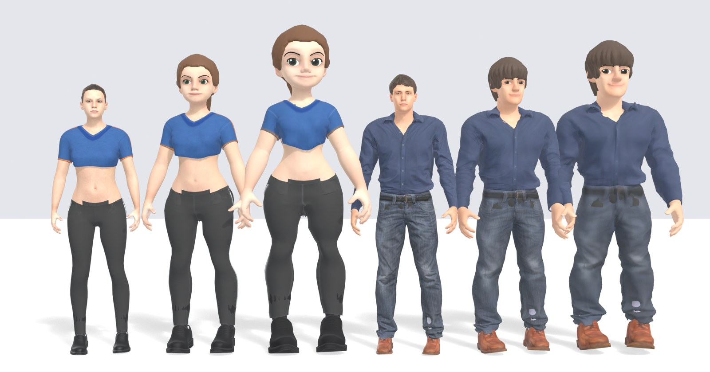

# Human Studio

A native Rust character editor for Bevy 0.20 and Avian3D 0.8. The expanded
customization engine ports Ara 3D Gen's MakeHuman morph lattice, proxy fitting,
rigging, anatomy adjustments and animation playback into Rust. MPFB2 contributes
published-format interoperability and custom-target workflows. Character
construction, editing, rendering, animation and export run without Node, Python,
Blender, a web server or an external generator.

## Cartoon mode

Cartoon mode turns any character into a stylised, toy-like version of itself: a bigger
head and eyes, almond eye openings, a smiling mouth, chunkier hands, wider hips or
broader shoulders, and painted-style faces and hair. It is a layer on top of the
MakeHuman body, not a separate model, so every body, face, wardrobe, rig and animation
control keeps working.



### Using it

- **Editor:** tick **Cartoon mode** and set the **Cartoon** amount (0 = realistic,
  1 = full cartoon).
- **Recipes:** `"cartoon": {"enabled": true, "strength": 1.0}`.
- **Command line:** `human-cli export --preset "Athletic woman" --set cartoon.enabled=true -o woman.glb`.



### What it changes

- **Body:** female and male cartoon shapes blend with the gender slider and scale with
  height. Children keep the cartoon head with a lighter body. At **Muscle** 1 the body
  reaches the muscular references in `references/`; lower values blend toward the
  regular cartoon shape.
- **Face:** flat skin, cartoon eyes with a large iris and highlight, eyes that sit almost
  flush with the face, solid brows, a single lash line on each upper lid, and painted
  beards. Blinks, expressions and speech shapes are resized to match.
- **Hair:** each MakeHuman hairstyle becomes a solid, sculpted shell with rounded locks.
  The hair tint still applies.
- **Animation and clothing:** the same clips play; arms are spread a little to clear the
  wider body. Garments are refitted and kept in their layers.

The same result appears in the preview and in every export.

**Limits:** the finest sculpted detail (lid edges, muscle definition) is softened by the
MakeHuman mesh resolution. Detail face sliders keep their realistic range, so they read
smaller on cartoon features. A few MakeHuman fringes cover one eye as solid shapes.

### Rebuilding the cartoon data

The cartoon shapes, hair shells and lash lines are prebuilt assets. They only need
rebuilding after changing the fitting tools or the reference models in `references/`:

```sh
python3 tools/cartoon_hm08/build.py   # body, face and lashes (NumPy, SciPy)
python3 tools/cartoon_hair/build.py   # hair shells (also Blender)
```

## Run

```sh
cd character_editor
cargo run --bin human-editor
```

The source includes the prepared native asset library. Initial Cargo builds need
network access for Rust dependencies; the editor then works offline. The default
asset directories are resolved from the crate location. The native window needs
a display and a Bevy/wgpu-compatible GPU. Linux uses X11; X11/XKB development
libraries and a working graphics driver must be available.

See [CLI and wardrobe workflows](docs/CLI.md) for garment authoring, reusable
outfits, sampled fit reports and animated exports.


## Universal Animation Libraries

Quaternius UAL1 and UAL2 can be imported with the native `animation-import`
command. Their 120 and 134 clips use separate `ual1:` and `ual2:` IDs and appear
in the GUI animation search and CLI clip catalog. The importer also reads each
root-motion companion. See [import and export commands](docs/CLI.md#universal-animation-libraries).
The source packs are not included in this repository; download them from Quaternius
(CC0 1.0). The clips already imported by the editor are included.

## Customization

The full editor starts with a clothed, textured and animated character. It has:

- 49 parameter controls: body/age/heritage, skin, eyes, brows, lashes, hair,
  beards, tattoos, earrings, clothing, fabrics, footwear, headwear, accessories,
  weapons, bags, vehicles, expressions, teeth, tongue, detail and rig settings.
- All 219 detail sliders and 1,037 source morph targets, including coupled body
  macros. Heritage weights normalize when evaluated. Age uses the reference's
  12–90 year range. The source's clothing/underwear rules for younger characters
  are retained.
- 20 photo-based skins, automatic skin selection, tint colors, 30 complete
  presets, and deterministic seeded randomization.
- 119 fitted garment/appearance/prop templates with separate surfaces, native
  layering selections and body-face hiding. Pattern and primary/accent colors
  are editable per garment; hair, beard, tattoo and metal colors are independent.
- Game, game-lite and full MakeHuman skeletons, A/T bind poses, optional facial
  bones, a `WeaponR` attachment socket and 77 sampled animation clips.
- Facial expressions, native blinks and speech preview, optional 34 facial
  shape/viseme targets, and native lip closure/heel arch adjustments.
- Low/medium/high mesh density, textured GLB and OBJ export, undo/redo,
  recipe save/load and a searchable detail panel.

Right-drag the viewport to orbit, scroll to zoom, or use Front/Side/Back and the
body/face framing buttons. Changes are rebuilt on a worker thread after a short
debounce. The previous valid character stays visible until its replacement is
ready. Animation and camera input run in Bevy; Avian receives a capsule sized to
the generated character. Animation previews stay in place so the game controller
can own root movement and physics. The original 24-control editor and its drop
test remain available through **Basic editor**. Switching modes preserves the
full native recipe as a saved draft, including its custom targets.

The native implementation uses reusable fitted geometry and sampled motion data
rather than executing the reference's JavaScript procedural generators. Garment
fit and motion retargeting should be reviewed for extreme proportions. Low detail
uses the canonical body mesh when clothing occlusion is active to preserve garment
boundaries. High mesh density refines triangles; it is not a skin-detail sculpt.
The bicycle is a native scene prop. This is a character editor for game integration, not a port
of Blender, Rigify, or every MPFB panel. FBX export and Blender material node
graphs are not implemented.

## MPFB / MakeHuman interoperability

The MPFB panel imports `.target` and `.target.gz` files against hm08's original
vertex numbering. Imported deltas travel inside the recipe, can be weighted or
mirrored across X, and participate in native character generation. File offsets
remain MakeHuman Y-up XYZ decimeters; they are not converted into Blender's Z-up
coordinate frame.

MHM import/export supports the documented body macros, compatible detail controls
and recognized MakeHuman assets. Unsupported geometry-changing directives return
an error. Standard MHM directives represent the interoperable subset; a validated
`# human-studio` JSON comment preserves the complete native recipe, including
procedural wardrobe, colors and custom deltas, when reopened in Human Studio.
Other applications ignore that comment and only receive the standard subset.
Use Human Studio JSON for complete editable projects.

## Custom wardrobe library

For the imported cartoon items, enable **Cartoon mode**, then select clothing
under **Clothing → Custom wardrobe** and hairstyles or beards under
**Hair → Custom hair & beards**. Each slot can be selected independently to mix
items from different source characters. Restart the editor after installing or
updating catalog files; its catalog is loaded at startup.

Place imported custom-garment JSON definitions in
`assets/native/custom_garments/`. The native asset loader validates every
`*.json` definition once when it starts, including any `map`, `diffuse`,
`normal`, or `normalMap` texture path relative to `assets/native`. The Clothing
panel groups usable definitions by slot. Selecting a top, bottom, jacket, feet,
or hat replaces the custom item in that slot; accessories toggle independently
by ID. A selection clears the conflicting built-in outfit/slot setting and
keeps custom garments in the other slots. Invalid definitions and missing textures
remain visible in the panel as errors and never interrupt character rebuilding.
Selected garments are stored directly in Human Studio recipes, so save/load and
runtime rebuilding do not depend on the source library still being present.

Imported hair, beards and clothing refit whenever the head or body changes.
Their body anchors follow the morphed surface. A shared deformation field
rotates and scales each item's authored offset, using the broader head/body
transform for distant strands and bounded local adjustments near the skin. This
also supports direct vertex bindings used by beard shells and scalp linings.
The fit runs after cartoon, custom-target and body-shape changes; source
geometry in saved recipes stays unchanged, so switching shapes does not
accumulate deformation. Imported hair also receives bounded clearance at the
scalp and neck; inward wig surfaces are preserved. Deep intersections remain
reported for asset review. The viewport and native exports use the same fit.

## Native command line

The complete [headless CLI reference](docs/CLI.md) covers discovery, all parameter
and detail controls, custom targets, MHM conversion, validation,
inspection, Basic projects, and manifest-based batch exports. Use `human-cli`,
or `human-editor --headless` with an editor build. CLI-only builds exclude the
window event loop and X11 integration:

```sh
cargo build --no-default-features --bin human-cli
./target/debug/human-cli --help
./target/debug/human-cli create --preset "Athletic woman" --output woman.json
./target/debug/human-cli export --input woman.json --clip walk --output woman.glb
```

The headless authoring binary uses exactly the same Rust generator and exporter:

```sh
cargo run --no-default-features --bin human-export -- --list
cargo run --no-default-features --bin human-export -- \
  --preset "Athletic woman" --out exports/woman.glb --clip walk
cargo run --no-default-features --bin human-export -- \
  --params exports/character.json --out exports/character.glb --all-clips
cargo run --no-default-features --bin human-export -- \
  --seed 42 --out exports/npc.obj
```

`--params` accepts a Human Studio project, a native recipe, or reference-style
parameter JSON. `--assets DIR` overrides the native asset directory. GLB embeds
textures, materials, selected rig/animation data and optional facial targets;
OBJ writes an MTL and adjacent PNG textures. Export parameters also let you
choose static, rigged or animated GLB output.

## Embed in a game

```toml
[dependencies]
human_editor = { path = "../character_editor", default-features = false }
# Match this crate's Bevy and Avian versions in the host.
```

```rust,no_run
use avian3d::prelude::*;
use bevy::prelude::*;
use human_editor::{CharacterPlugin, CharacterRecipe, CharacterShape};
use human_editor::{ara::AraRecipe, native_runtime::NativeAssets};

fn configure(app: &mut App, assets: NativeAssets) {
    // The host installs DefaultPlugins and PhysicsPlugins once.
    app.insert_resource(assets).add_plugins(CharacterPlugin);
}
fn spawn_character(mut commands: Commands) {
    commands.spawn((
        CharacterShape(CharacterRecipe {
            customization: Some(AraRecipe::default()),
            ..default()
        }),
        Transform::from_xyz(2.0, 0.0, 0.0),
        RigidBody::Kinematic,
    ));
}
```

Load `NativeAssets::load(".../assets/native")` once and share it across characters.
Change `CharacterShape.0.customization` to rebuild. `NativeInstance` exposes the
built character, clip selection, playback and time. Meshes, native images and
materials belong to managed child entities; root destruction removes them.
Failed recipes attach `CharacterBuildError` and are retried only after a change.
Each character retains its own configuration and locomotion collider. Roots use
meters, Y-up, feet at their local origin, facing +Z.

`CharacterPlugin` creates no camera, lights, floor, UI, or physics world. It also
supports the original lightweight morph library through `CharacterLibrary` and
recipes without `customization`. When both engines are used, insert both library
resources. Standalone and in-game editor examples do this explicitly.

With the `editor` feature, add `CharacterEditorUiPlugin` for the panels without
creating another scene. Set `EditorState.selected` to a host-owned character.
Mark a camera with `EditorCamera` to opt into orbit controls. Selection transitions
reset history and restore an active basic drop preview's original physics state.
`CharacterEditorPlugin` combines those panels with the standalone studio scene.

```sh
cargo run --example in_game_editor
cargo run --no-default-features --features window --example embedded
```

Live editable instances use CPU skinning. For production GPU skinning and
pre-authored game characters, load exported GLBs with Bevy's normal scene and
animation APIs; the game then needs neither the generator nor its source assets.

## References, assets and licenses

[Third-party notices](THIRD_PARTY.md) records source revisions, attribution and
licensing. `references/` holds the cartoon reference models and style sheets that the
cartoon build fits to. [Native asset provenance](assets/native/PROVENANCE.json) records file
hashes. The original small library's provenance remains under
`assets/makehuman/PROVENANCE.md`.

The reference TypeScript/Python/Blender applications are not runtime dependencies.
The development-only scripts under `tools/` convert catalogs, procedural source
geometry, paint masks and sampled animation data into portable assets. Those
scripts use the vendored pinned Ara source; they are not called by Cargo, the
editor, the Rust library or exports. MakeHuman graphical data is CC0. Ara's code
is MIT; its required notice is included. CMU-derived motion data has separate
terms, including the restriction against reselling motion data by itself.
MPFB's Blender code is GPL and has not been incorporated; the format reader is
an independent implementation of its published conventions.

## Validation

```sh
cargo fmt --check
cargo check --all-targets
cargo test --lib --tests
cargo check --no-default-features --features window --example embedded
HUMAN_EDITOR_SMOKE=/tmp/human-studio.png cargo run --bin human-editor
```

The smoke option waits for the native character build, captures the rendered
window, then exits. Tests cover real native characters, morph extremes, parsing,
MHM/custom-target interchange, anatomy adjustments, rigs/motion, asset reuse,
Avian ground contact, persistence and GLB import into Bevy.
